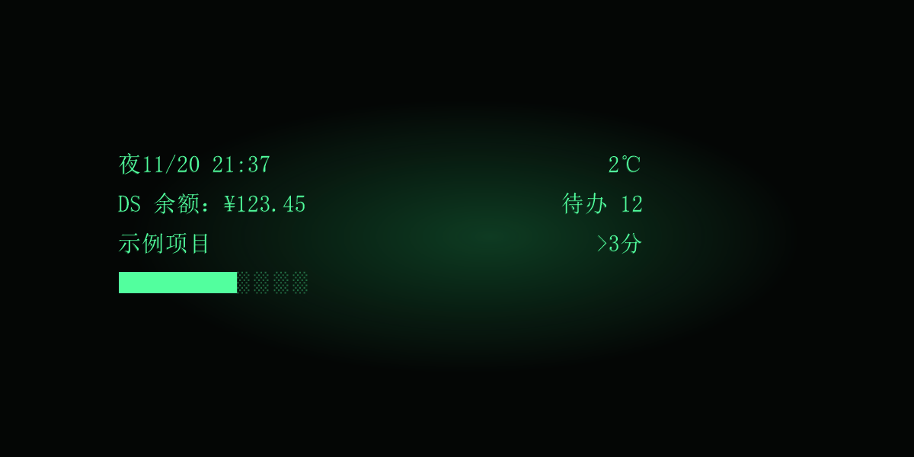
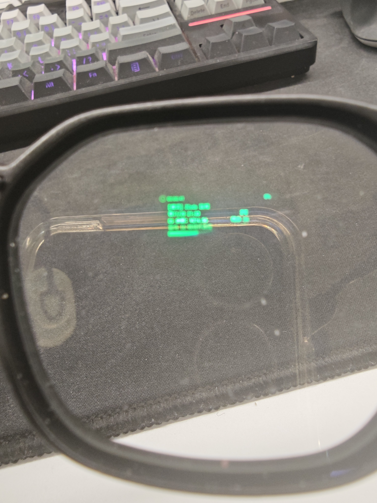

# glasses-hud

> 把编程 Agent（ZCode）的会话进度、余额、待办和天气，做成一块**常驻在智能眼镜上的看板**。
> 你人在电脑外，抬眼就知道：哪个项目在跑、跑到哪、还剩多少、今天什么温度。



<sub>效果图由 `tools/render-hud-mock.ps1` 用实时 HUD 数据生成，仅用于示意。</sub>



<sub>实拍：雷鸟 iO 波导显示（手机对焦波导会糊，肉眼更清晰）。</sub>

> ⚠️ **适用范围：仅雷鸟 iO（RayNeo iO）**
>
> 本项目依赖雷鸟 iO 的**提词器通道**（CoreConnect `TELEPROMPTER = 0x14`）和
> 官方雷鸟 AI App 的会话协议，**只在这套硬件 + App 上验证过**。
>
> 换成其他眼镜（RayNeo X3 / Air 系列、其他品牌）**不能直接使用**：
> 眼镜端的显示通道、配对协议、App 生态都不同，需要针对目标设备重新做对接
> （重写 `hud-module`，或另找该设备的常驻显示能力）。
>
> 可复用的部分是**数据侧**：`bridge/` 的 `/v1/hud` 纯文本接口、状态模型和版式
> 经验，原则上可以接给任何“能常驻显示文本”的设备。

---

## 它由两部分组成

```
┌─ 电脑（Windows/macOS/Linux）──────────────┐      ┌─ 手机 ────────────┐     ┌─ 眼镜 ─┐
│ ZCode 数据库（只读）                      │      │ 雷鸟 AI App        │     │ 提词器  │
│   ~/.zcode/cli/db/db.sqlite               │ HTTPS│ + LovelyRayNeoio   │蓝牙 │ 常驻页  │
│        │ 轮询 / 事件 hook                  │◄────►│   补丁 + HUD 模块  │────►│ 绿字看板 │
│   bridge（Node，零依赖）                   │      │ 自定义模型 / 轮询   │     │        │
└───────────────────────────────────────────┘      └───────────────────┘     └────────┘
```

- **`bridge/`**：本仓库的 Node 服务。只读 ZCode 数据库，对外提供
  `/v1/state`、`/v1/hud`、`/v1/chat/completions`（OpenAI 兼容）等接口。
- **`hud-module/`**：一个 Java 类，装进
  [LovelyRayNeoio](https://github.com/Tokeii0/LovelyRayNeoio) 补丁版 App 里，
  轮询 `/v1/hud` 并通过**眼镜提词器通道**推送常驻看板。安装步骤见
  [`hud-module/README.md`](hud-module/README.md)。

> 本项目是**非官方**的，与雷鸟（RayNeo）无关。眼镜端 App 需要用 LovelyRayNeoio
> 自行构建，官方 APK 请从官方渠道下载——本仓库**不分发任何 APK/固件**。

## 能力

| 能力 | 说明 |
|---|---|
| 看板 | 日期/昼夜、气温、DS 余额、飞书待办数、项目名/状态/已跑时长、10 格进度条 |
| 语音开关 | “跟随电脑”启动看板；镜腿退出即关闭，恢复眼镜原生功能 |
| 问答 | 自定义模型接入后可用自然语言问项目状态/待办/日程/妙记/搜索 |
| 跟随 | 选定项目后，看板持续显示其进度 |

## 快速开始（bridge）

需要 Node ≥ 22.5（使用内置 `node:sqlite`）。

```bash
git clone <this-repo> glasses-hud && cd glasses-hud
node bridge/bridge.mjs            # 默认 127.0.0.1:8790
```

首次运行会生成 `.state/bridge.token`。自测：

```bash
TOKEN=$(cat .state/bridge.token)
curl -s -H "Authorization: Bearer $TOKEN" http://127.0.0.1:8790/v1/hud
```

把 `--host 0.0.0.0` 打开可让局域网访问；跨网访问建议用私有 overlay 网络
（例如 `tailscale serve --bg 8790`），**不要直接端口映射到公网**。

### 可选功能

- **气温**：默认用 `wttr.in`（按出口 IP 定位），10 分钟缓存并落盘。
- **DS 余额**：从 `~/.zcode/v2/provider_config.json` 读取 DeepSeek key，调用
  `GET /user/balance`，10 分钟缓存。
- **飞书待办数**：通过 `lark-cli`（用户身份）读取“我负责的未完成”总数。
  需要本机已安装并登录 `lark-cli`；未安装时该位置留空。
- **LLM 兜底**：`llm.example.json` → `.state/llm.json`，规则答不上的问题转给
  大模型；`apiKey` 支持 `from-zcode:<providerId>` 引用，无需复制密钥。

## 手机 + 眼镜侧

1. 用 [LovelyRayNeoio](https://github.com/Tokeii0/LovelyRayNeoio) 对自己从官方
   渠道下载的雷鸟 AI APK 打补丁（其 README 有完整步骤）。
2. 把 [`hud-module/ZcodeHudBridge.java`](hud-module/ZcodeHudBridge.java) 放进
   `custom_ai_mod/src/com/rayneo/customai/`，按
   [`hud-module/README.md`](hud-module/README.md) 做 3 处小改动后重新打包。
3. App 的 ⚡LLM 面板里填自定义模型：
   - 地址：`https://<你的主机>/v1`（协议选 **Chat /chat/completions**）
   - Key：`.state/bridge.token`
   - 模型名：任意
4. 对眼镜说“**跟随电脑**”启动看板；按镜腿退出即关闭。

### 语音指令

| 说 | 效果 |
|---|---|
| **跟随电脑** | 启动看板（旧口令“提词器/打开提词器”仍兼容） |
| 停止跟随电脑 | 停止看板（镜腿退出等效） |
| 项目列表 → 第 N 个 → 跟随电脑 | 切换跟随的项目 |
| 跟随第 N 个项目 / 打开某项目 | 直接选中项目（说“跟随电脑”后生效） |
| 我的待办 / 今天日程 / 最近的妙记 | 飞书数据 |
| 家里电脑在干什么 | 项目状态总览 |

## 版式约定（眼镜提词器通道）

- 每行最多 **34 个半角单位**，本项目的右边界统一取 **33** 以避免换行。
- 右列不放空格（空格会被渲染成换行点），状态用 ASCII 符号：`>运行` `.空闲` `!等确认`。
- 时长压缩：`<60s` 用秒、`<60m` 用分、否则 `时+分`。
- 方块字符 `█/░` 比估算更宽，进度条只放 10 格且右侧不再跟百分比。
- 眼镜字体缺少 emoji（`☀/🌙/🌡`）和部分符号（`☾`），昼夜用汉字“日/夜”。

更多踩坑记录见 [`docs/design-notes.md`](docs/design-notes.md)。

## 运行与保活

- Windows：`run-bridge.ps1` 启动（带健康检查、单实例），
  `register-task.ps1` 注册登录自启计划任务。
- 其他平台：用 systemd / launchd / supervisor 托管 `node bridge/bridge.mjs`。

## 隐私与边界

- bridge **只读** ZCode 数据库，不写入、不控制会话。
- 看板内容会经手机 App 与（可选的）LLM 服务处理；LLM 会把状态摘要发给模型供应商。
  不想外发就删掉 `.state/llm.json`。
- 眼镜**电量**目前读不到（标准 Battery Service 返回空），因此不显示。
- 提词器与语音互斥：看板开启时语音助手不可用，这是通道本身的限制；所以做成
  “说提词器才开、退出即关”。

## License

MIT（本仓库自有代码）。依赖与第三方项目的许可**不覆盖**：LovelyRayNeoio 为
AGPL-3.0 + Commons Clause，Turbo-IO 为 PolyForm Noncommercial。详见 [LICENSE](LICENSE)。
本仓库不包含、也不分发任何官方 APK 或固件。

## 联系

- Email: fish.h@foxmail.com
- Issues / Discussions: 本仓库

---

## English (short)

**glasses-hud** turns a pair of **RayNeo iO** glasses into a persistent HUD for your
coding agent. It relies on the iO's teleprompter channel and the official RayNeo AI
app protocol, and has only been verified on that hardware. Other glasses (RayNeo X3,
Air series, other brands) **cannot use it as-is** — their display channels and app
stacks differ, so the glasses-side module would need to be rebuilt for that device.

Say “提词器” to show the HUD, exit with the temple button to get the glasses back.
Unofficial project, not affiliated with RayNeo. MIT for our code; no APKs or
firmware are distributed. See `SECURITY.md` before exposing the bridge.
